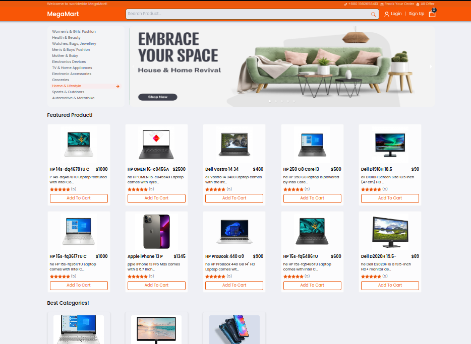

# MegaMart - E-commerce Store

Responsive e-commerce web application built with React and Redux featuring a product catalog, category navigation, product ratings, and shopping cart.



## Features

- Product catalog with search bar and department sidebar navigation
- Featured products grid with customer star ratings and pricing
- Shopping cart state management with Redux
- Responsive design built with Tailwind CSS

## Tech Stack

- React.js
- Redux Toolkit
- Tailwind CSS
- JavaScript (ES6+)
- React Router

## Getting Started

1. Clone the repository:
```bash
git clone https://github.com/davyd9/megamart-ecommerce-react.git
cd megamart-ecommerce-react
```

2. Install dependencies and start the project:
```bash
npm install
npm run dev
```
